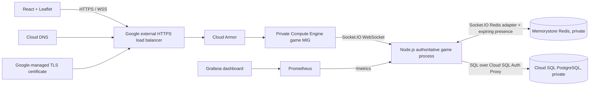

# Wayfinder

Wayfinder is an original, real-time multiplayer city exploration game. Players move around an OpenStreetMap, meet nearby explorers, collect city sparks, and complete location-based routes. The project is built to show practical networking and security decisions rather than just draw a map with live dots.

## Project structure

```text
marauders-map/
├── backend/                 Express, Socket.IO, auth, game authority, SQL migrations
├── frontend/                React, TypeScript, Vite, Leaflet UI and nginx image
├── shared/                  Typed REST/game event shapes and geo helpers
├── infrastructure/
│   ├── terraform/            GCP VPC, MIG, HTTPS LB, Cloud SQL, Redis, DNS, Armor
│   └── kubernetes/           GKE deployments, services, ingress, certificate, HPA
├── monitoring/
│   ├── prometheus/           Scrape configuration
│   └── grafana/              Provisioned Prometheus source and dashboard
├── load-testing/k6/          50/100/500 virtual-player WebSocket scenario
├── docker-compose.yml
└── .env.example
```

## Architecture



The browser uses HTTPS for account and profile REST calls. Socket.IO is configured for WebSocket transport, and the load balancer upgrades that connection to WSS. Long polling is disabled, so each game connection stays on one backend and does not require sticky sessions. The Redis Socket.IO adapter distributes room events across game processes; expiring Redis player records provide shared snapshots. PostgreSQL stores accounts and rewards. Redis holds short lived game presence only.

The game server owns player movement. A client sends its desired next step with a sequence number and timestamp. The server checks coordinate bounds, packet age, sequence order, per-player message rate, and movement speed before updating shared state and broadcasting. A browser click is treated as a destination; the client walks there in small steps within the server speed limit.

## Local run

### Docker Compose

Requirements: Docker Desktop with Compose v2. From the project directory:

```powershell
Copy-Item .env.example .env
docker compose up --build
```

Open [http://localhost:8080](http://localhost:8080). The local Compose file uses development-only database, JWT, and Grafana passwords. Replace them before sharing this environment. The API is available on port 3001, PostgreSQL on its private Compose network, and Redis on its private Compose network.

Optional Prometheus and Grafana:

```powershell
docker compose --profile monitoring up --build
```

Open Prometheus at `http://localhost:9090` and Grafana at `http://localhost:3000` (`admin` / the `GRAFANA_PASSWORD` value, defaulting to a local-only placeholder). Change that password for any shared machine.

### Run the frontend and API separately

```powershell
Copy-Item .env.example .env
npm install
npm run dev
```

The Vite dev server proxies `/api`, `/health`, `/ready`, and Socket.IO to port 3001. When PostgreSQL is unavailable in development, the API starts in a single-process in-memory mode so the app can be tried without Docker. Accounts, friend links, rooms, and scores in that mode reset when the API restarts; use Docker Compose for persistent local development. Redis is optional for one local API process and is required for cross-instance socket events.

## Account and game flow

Create a field name and password (10–72 characters) and choose an avatar. On the room screen, “Center local quests on my GPS” asks for one device fix so your private quest map and collectibles spawn around your actual area. This does not share your location. To publish live GPS updates, join a private room and explicitly start a timed share; the browser then provides GPS updates until you stop sharing or the timer ends. Shared destinations draw a labeled direct-distance guide, and proximity alerts are limited to opted-in sharers in that room. The map uses OpenStreetMap tiles and starts around Pune only when device centering is skipped. Map clicks place shared destinations; movement comes from GPS while sharing.

Run the local integration check with `npm test`. It starts an isolated in-memory API on a free port and uses fictional accounts and synthetic coordinates.

## REST API

| Method | Path | Purpose |
| --- | --- | --- |
| `POST` | `/api/auth/register` | Create account, hash password with bcrypt, return JWT |
| `POST` | `/api/auth/login` | Verify credentials and return JWT |
| `GET` | `/api/profile` | Authenticated profile and score |
| `GET` | `/api/players` | Authenticated online player snapshot |
| `GET` | `/api/missions` | Authenticated player's GPS-centered quest list for the current room |
| `GET` | `/health` | Process health for load balancers |
| `GET` | `/ready` | PostgreSQL readiness and Redis status |
| `GET` | `/metrics` | Prometheus metrics |

## Socket.IO protocol

Socket.IO is a message protocol carried over a WebSocket transport. Connection auth is sent in the Socket.IO handshake (`auth.token`) and checked as a JWT. Both directions are typed in `shared/src/index.ts`.

| Direction | Event | Payload / behavior |
| --- | --- | --- |
| C → S | `game:join` | Initial map position; ack returns snapshot, private local quests, and collectibles |
| C → S | `player:move` | `{ position: {lat,lng}, sequence, timestamp }`; rejected if invalid/too fast |
| C → S | `player:status` | `exploring`, `on-mission`, or `resting` |
| C → S | `player:visibility` | `visible`, `approximate`, or `hidden` |
| C → S | `mission:start` / `mission:complete` | Server checks route id and distance to target |
| C → S | `item:collect` | Server checks existence, proximity, and one-time claim |
| C → S | `net:ping` | Client timestamp; server returns `net:pong` for RTT |
| S → C | `game:snapshot` | Current map state |
| S → C | `player:joined`, `player:moved`, `player:left`, `player:updated` | Distributed presence changes |
| S → C | `mission:updated`, `item:collected` | Game mechanic results |
| S → C | `game:error` | Safe user-facing code and message |

Socket.IO's own ping interval is 20 seconds with a 15-second timeout. The game also samples RTT every 3.5 seconds. Reconnection is automatic. Redis player keys expire after 90 seconds and are refreshed by movement and game pings.

## Data and Redis

The migration at `backend/migrations/001_init.sql` defines users, reward claims, game sessions, and player statistics. GPS-centered quest targets stay in process memory and are returned only to the authenticated player's own map; quest reward claims store quest IDs and points, not target coordinates. Passwords are bcrypt hashes; JWTs and passwords are never logged. Reward writes use database uniqueness and transactions to prevent replay from awarding points twice.

Redis uses `wayfinder:player:{userId}` JSON values with a 90-second TTL and the `wayfinder:collected:{itemId}` key for one-day distributed collectible claims. The Socket.IO Redis adapter publishes game room events between processes. Redis is not the permanent account or score store. If Redis is down, a process continues with local presence and reports degraded readiness; cross-instance presence is temporarily unavailable.

## Local containers and observability

`docker compose up` starts frontend, API, PostgreSQL, and Redis. `docker compose --profile monitoring up` adds Prometheus and Grafana. The dashboard graphs open sockets, messages per second, p95 RTT, rejected movement, disconnect/reconnect rates, accepted moves, WebSocket errors, process CPU/memory, and estimated Socket.IO payload throughput. Payload bytes exclude TCP/TLS framing; on GCP, the VM's actual CPU, memory, and network traffic are available from Cloud Monitoring's VM metrics. Container logs are JSON on stdout and the Ops Agent forwards Docker logs to Cloud Logging.

Useful local checks:

```powershell
docker compose ps
docker compose logs backend
curl.exe http://localhost:3001/health
curl.exe http://localhost:3001/ready
curl.exe http://localhost:3001/metrics
docker compose exec postgres psql -U wayfinder -d wayfinder -c "select username,score from users;"
docker compose exec redis redis-cli ping
```

The live UI reports approximate round-trip time. The browser's WebSocket-only transport and the Engine.IO handshake can be inspected in browser developer tools under Network → WS.

## Network lab

The side panel's **Network lab** simulates delayed movement packets and message bursts. Slow link adds delay to movement updates. Packet burst sends more move packets than the per-player limit, which should trigger a safe error. The client walks toward a clicked destination in small steps; authoritative server updates then reconcile the marker position. This is a development demonstration, not an operating-system packet shaper.

## k6 load scenarios

The script creates a temporary test account per virtual user, opens a Socket.IO WebSocket, joins the map, and sends heartbeat samples. It measures HTTP failures and WebSocket handshake time and creates custom connection/error observations. No performance results are claimed here; run the scenarios in your own environment and keep the k6 output with the tested image/version.

Run against local Compose, one at a time:

```powershell
$env:BASE_URL = "http://localhost:8080"
$env:TARGET_VUS = "50"
k6 run load-testing/k6/game.js
$env:TARGET_VUS = "100"
k6 run load-testing/k6/game.js
$env:TARGET_VUS = "500"
k6 run load-testing/k6/game.js
```

Compose raises API/auth request limits for local load exercises only. Production defaults are 120 API requests per minute and 20 auth attempts per 15 minutes per process/IP. For a staging load run, set `API_RATE_LIMIT_MAX` and `AUTH_RATE_LIMIT_MAX` to fit the planned run, and set Terraform's `armor_rate_limit_per_minute` high enough for that controlled run. Use throwaway accounts/data and restore production values afterward. Capture backend CPU/memory in Grafana or Cloud Monitoring during each run. A single-node run does not demonstrate load balancing.

## GCP setup

GCP infrastructure is prepared as Terraform, but it has not been provisioned from this workspace. Deploying it creates billable resources (regional Cloud SQL, HA Memorystore, a load balancer, and at least two VMs). The exact values you must supply are:

1. A GCP project ID with billing enabled and permission to enable APIs, create IAM bindings, networking, Cloud SQL/Redis, load balancing, DNS, and Compute Engine resources.
2. A domain you own, delegated at its registrar to the Cloud DNS name servers Terraform returns. The example `play.example.com` is a placeholder, not an owned domain.
3. Immutable backend and frontend Artifact Registry image tags.
4. A 24+ character URL-safe Cloud SQL password (`A–Z`, `a–z`, digits, `_`, `-`) and a random JWT secret of at least 32 characters.
5. Region/zone choices. Defaults are `asia-south1` and `asia-south1-a`.

Provision in two passes so the images exist before the managed instance group boots:

```powershell
gcloud auth login
gcloud config set project YOUR_GCP_PROJECT_ID
gcloud services enable artifactregistry.googleapis.com
gcloud artifacts repositories create wayfinder --repository-format=docker --location=asia-south1
gcloud auth configure-docker asia-south1-docker.pkg.dev
docker build -f backend/Dockerfile -t asia-south1-docker.pkg.dev/YOUR_GCP_PROJECT_ID/wayfinder/backend:v1 .
docker build -f frontend/Dockerfile -t asia-south1-docker.pkg.dev/YOUR_GCP_PROJECT_ID/wayfinder/frontend:v1 .
docker push asia-south1-docker.pkg.dev/YOUR_GCP_PROJECT_ID/wayfinder/backend:v1
docker push asia-south1-docker.pkg.dev/YOUR_GCP_PROJECT_ID/wayfinder/frontend:v1
```

Then create the Terraform-managed resources. `terraform.tfvars.example` is a placeholder to copy to a local, ignored `terraform.tfvars`; fill in project, owned domain, and image tags. Set sensitive inputs in the PowerShell process environment rather than saving them in that file:

```powershell
Copy-Item infrastructure/terraform/terraform.tfvars.example infrastructure/terraform/terraform.tfvars
$env:TF_VAR_db_password = "REPLACE_WITH_24_PLUS_URL_SAFE_RANDOM_CHARACTERS"
$env:TF_VAR_jwt_secret = "REPLACE_WITH_AT_LEAST_32_RANDOM_CHARACTERS"
Set-Location infrastructure/terraform
```

Create a restricted, versioned Cloud Storage bucket before Terraform init. Terraform state contains secret values even when variables are marked sensitive. Do not commit state, plan files, or `terraform.tfvars`.

```powershell
$stateBucket = "YOUR_GCP_PROJECT_ID-wayfinder-tfstate"
gcloud storage buckets create "gs://$stateBucket" --location=asia-south1 --uniform-bucket-level-access
gcloud storage buckets update "gs://$stateBucket" --versioning
terraform init -backend-config="bucket=$stateBucket" -backend-config="prefix=wayfinder/prod"
```

Terraform also defines the Artifact Registry repository, so if you created it in the bootstrap step above, import it before `plan`. Then format, validate, inspect the plan, and apply:

```powershell
terraform import google_artifact_registry_repository.images projects/YOUR_GCP_PROJECT_ID/locations/asia-south1/repositories/wayfinder
terraform fmt -recursive
terraform validate
terraform plan -out wayfinder.tfplan
terraform apply wayfinder.tfplan
terraform output
```

Terraform provisions a custom VPC/subnet, Cloud NAT, private service access, private Cloud SQL PostgreSQL, TLS enabled Memorystore, VM service account and Secret Manager entries, a private Compute Engine MIG, external managed HTTPS load balancer, Cloud Armor rate rule, Cloud DNS A record, and Google-managed certificate. The app nodes have no public IP. SSH is allowed only through IAP. The Cloud SQL Auth Proxy runs alongside the backend container and Cloud SQL is not given a public address.

After apply, add every `cloud_dns_name_servers` value from `terraform output` as the nameservers for the domain (or the delegated subdomain) at your registrar. Point-of-domain DNS delegation is an external registrar action; the Terraform A record is already created. Google-managed TLS provisioning starts after DNS resolves to the load balancer and can take time. Check status with:

```powershell
gcloud compute instances list
gcloud compute backend-services get-health wayfinder-backend --global
gcloud compute ssl-certificates describe wayfinder-cert --global
gcloud dns record-sets list --zone wayfinder-zone
curl.exe -I https://YOUR_DOMAIN
```

The WSS endpoint is the same origin as the site, at `/socket.io/`. Confirm the browser shows a WebSocket (`101 Switching Protocols`) in developer tools. The configured WebSocket-only transport avoids session affinity. If long polling is re-enabled later, either enable load-balancer affinity or preserve Socket.IO session routing.

## GKE option

The Kubernetes manifests are an alternative deployment path, not required for the initial VM deployment. Replace the example project, domain, and image tags first. Create a GKE cluster attached to the VPC and private Memorystore network. Enable Workload Identity and bind the `wayfinder-runtime` Kubernetes service account to a Google service account with `roles/cloudsql.client`. `secret.yaml` contains obvious placeholders and must be replaced before apply. For production, create the Kubernetes secret from Secret Manager instead of committing secret values. The included config map also has placeholders for non-secret connection configuration.

```powershell
kubectl apply -f infrastructure/kubernetes/configmap.yaml
kubectl create serviceaccount wayfinder-runtime
kubectl create secret generic wayfinder-secrets --from-literal=JWT_SECRET="$env:JWT_SECRET" --from-literal=DATABASE_URL="$env:DATABASE_URL" --from-literal=REDIS_URL="$env:REDIS_URL"
gcloud secrets versions access latest --secret=wayfinder-redis-ca | Set-Content -Encoding ascii redis-ca.pem
kubectl create secret generic wayfinder-redis-ca --from-file=redis-ca.pem=redis-ca.pem
kubectl apply -f infrastructure/kubernetes/deployment.yaml
kubectl apply -f infrastructure/kubernetes/service.yaml
kubectl apply -f infrastructure/kubernetes/hpa.yaml
kubectl apply -f infrastructure/kubernetes/ingress.yaml
kubectl get pods,services,ingress
kubectl rollout status deployment/wayfinder-api
```

Each API replica is a pod. The ClusterIP service supplies stable in-cluster routing, and the GKE ingress provisions a Google load balancer and managed certificate. The API transport is WebSocket-only and Redis handles cross-pod broadcasts. Set the domain consistently in `CLIENT_ORIGIN`, ingress, and the managed certificate. Configure the GKE cluster's private service access and GKE node firewall/IAM before using the manifests.

## Verification reference

```powershell
# Local containers and dependencies
docker compose ps
docker compose exec postgres pg_isready -U wayfinder -d wayfinder
docker compose exec redis redis-cli ping
curl.exe http://localhost:3001/health
curl.exe http://localhost:3001/ready
curl.exe http://localhost:3001/metrics

# Cloud identity, project, instances, MIG and firewall
gcloud auth list
gcloud config get-value project
gcloud compute instances list
gcloud compute instance-groups managed list
gcloud compute firewall-rules list --filter="network:wayfinder-vpc"
gcloud compute backend-services get-health wayfinder-backend --global
gcloud sql instances describe wayfinder-postgres
gcloud redis instances describe wayfinder-redis --region=asia-south1

# GKE alternative
kubectl get pods
kubectl get services
kubectl get ingress
kubectl logs deployment/wayfinder-api
```

Testing two browsers with two accounts verifies presence, join/leave, movement, and cross-node events (the clients need to land on different backends to demonstrate Redis Pub/Sub). Use the backend `serverId` field and Cloud Logging to confirm which process handled each connection. A successful HTTPS page alone does not verify WSS or Redis cross-node fanout.

## Security checklist

- [x] Password hashing with bcrypt; JWT validation on REST and Socket.IO.
- [x] HTTPS/WSS at the GCP managed load balancer; TLS Redis and Cloud SQL Auth Proxy in the VM architecture.
- [x] Private VPC addresses for game VMs, Redis, and SQL; VM ingress only from load-balancer health-check ranges and IAP SSH.
- [x] REST and auth rate limits; WebSocket movement rate and packet-size limits.
- [x] Coordinate bounds, max walking speed, packet timestamp and sequence validation, duplicate reward protection.
- [x] Location visibility choice; approximate coordinates rounded before remote publication; hidden players are not broadcast.
- [x] Helmet headers, CORS allow list, parameterized SQL, JSON size limit, structured logs without passwords/tokens.
- [ ] Supply real secrets in Secret Manager and restrict Terraform state access before production.
- [ ] Delegate an owned domain and wait for the managed certificate to become `ACTIVE`.
- [ ] Replace placeholder image tags and test WSS, cross-instance fanout, alerts, backup restore, and load targets in the deployed environment.

## Networking concepts shown

OSI/TCP-IP boundaries, TCP connection lifecycle, HTTP REST, TLS/HTTPS and WSS, DNS resolution and delegation, WebSocket upgrade, heartbeat and RTT, client message validation, server authority, rate limiting, JWT auth, cloud load balancing, distributed Redis Pub/Sub, private subnet routing, VPC firewall policy, NAT egress, managed database access, Docker networks, Kubernetes pod/service/ingress, Prometheus metrics, and load simulation.

## Resume-ready description

**Wayfinder — Real-Time Multiplayer Networking Game:** Built a TypeScript multiplayer map game with an authoritative Socket.IO server, JWT/bcrypt authentication, validated movement and anti-replay checks, Redis Pub/Sub presence across game instances, PostgreSQL reward persistence, RTT/Prometheus monitoring, Docker Compose, k6 load scenarios, and Terraform for a private GCP network with Cloud SQL, Memorystore, Compute Engine autoscaling, HTTPS load balancing, Cloud Armor, Cloud DNS, and managed TLS. Performance figures should be added only after running and recording the 50/100/500 virtual-player tests.
